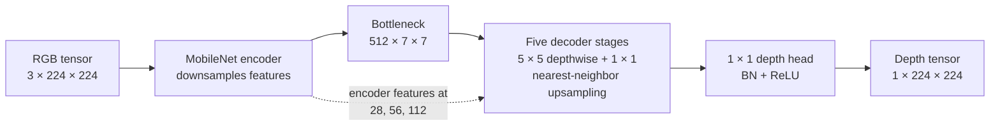

# FastDepth architecture: a detailed guide

This guide explains **what FastDepth computes, why its components are arranged that way, and the actual dimensions of the model in this repository**. It is intended to help you explain the architecture at a whiteboard as well as locate the corresponding code.

The primary references are the supplied [FastDepth paper](../../papers/fastdepth.pdf), the vendored [FastDepth model implementation](../../third_party/fast-depth/models.py), the [MobileNet encoder implementation](../../third_party/fast-depth/imagenet/mobilenet.py), and the recovered checkpoint's [explicit architecture](../../checkpoints/converted/community-skipadd-pruned.architecture.json). Our [architecture trace](../../results/checkpoints/2026-11-14-community-architecture-trace.json) records the dimensions and parameter counts below for one synthetic input on CPU. That trace checks architecture and execution, not prediction accuracy or Jetson speed.

## 1. What problem does the model solve?

FastDepth is a **monocular depth-estimation** model: it takes one RGB image and predicts a depth value at each output pixel. “Monocular” means there is a single camera image; the model is not given a second stereo view or a live depth sensor at inference time.

A single photograph does not uniquely determine physical depth. A small nearby object and a larger distant object can occupy the same number of pixels. FastDepth learns statistical clues from depth-labeled training examples, such as perspective, object appearance and typical room layouts. Its estimates can therefore be wrong when those learned patterns are ambiguous or the input differs from its training data.

For the recovered model in this project, the input is a floating-point tensor shaped **`[N, 3, 224, 224]`** and the output is **`[N, 1, 224, 224]`**. `N` is batch size; 3 means the red, green and blue channels; 1 means one predicted depth channel. Batch size one gives `[1, 3, 224, 224] → [1, 1, 224, 224]`. The output is a **numeric depth estimate**, not an RGB picture. A colored depth image used for display is a visualization derived from those numbers.

The original NYU labeled depth arrays are documented in metres, but the complete conversion history of our community-mirrored HDF5 data and checkpoint has not been independently verified. We therefore label measured errors in the mirror's **native depth units** until that chain is established. A model output is an estimate, not a physical sensor reading or a guarantee of metric calibration.

## 2. The overall idea

The model has three conceptual parts:

1. **Encoder:** reduce the image's spatial resolution and build increasingly complex feature maps.
2. **Decoder:** turn the low-resolution features back into a full-resolution prediction using convolution and upsampling.
3. **Skip connections:** add selected encoder features to decoder features at matching resolutions, helping retain spatial detail.



Each tensor size above is written as **channels × height × width**, omitting batch size. The three dashed connections are *additions*, not concatenations. The starting checkpoint is itself an already-pruned architecture: our subsequent experiments start from it rather than from the paper's unpruned model.

## 3. Input preparation: what arrives at the encoder?

For the local NYU HDF5 pipeline, `load_h5` reads an RGB array stored as `[3, 480, 640]` and transposes it to `[480, 640, 3]`. The project's `preprocess` function:

1. Resizes the image to **250 × 333** pixels using nearest-neighbor interpolation. Height is written first here; the Pillow resize call receives width first.
2. Takes a centered **228 × 304** crop.
3. Resizes the crop to **224 × 224**.
4. Converts RGB values to floating point in **[0, 1]** by dividing by 255, and changes HWC order to CHW.
5. Applies the corresponding spatial transformations to the paired depth map when ground truth is supplied.

This is the project's reproduction of the relevant pipeline, not a claim that every possible input has been proven identical to a historical environment. An adapted SciPy 1.1 source comparison matched the final tensors on six tested cases; see [dataset and preprocessing](dataset_preprocessing.md). The model forward pass itself expects the prepared tensor—it does not load HDF5 or perform these image transformations.

**Why keep RGB and depth transformations aligned?** A training pixel must correspond to the same image location as its target depth. Misaligned crops would teach the model incorrect associations.

## 4. Basic building blocks

### Convolution and feature maps

A convolution slides a small learned filter across a feature map. At each spatial location, it combines local values to produce another value. A **channel** is one 2D feature map; different channels can learn different useful patterns. The meaning of an individual learned channel is not necessarily a simple human-readable concept.

For one output dimension, convolution size is:

```text
output = floor((input + 2 × padding − dilation × (kernel − 1) − 1) / stride + 1)
```

With a 3 × 3 kernel, padding 1, dilation 1 and stride 2, a 224 × 224 input becomes 112 × 112. Stride controls how far the filter moves. Padding makes border locations available and controls output size. In this checkpoint the encoder uses 3 × 3 spatial depthwise filters; decoder spatial filters use 5 × 5 with padding 2 and stride 1, preserving spatial size until explicit upsampling.

### Depthwise and pointwise convolution

A **standard** convolution mixes information across input channels and neighboring pixels in one operation. A depthwise-separable block splits that work:

- **Depthwise convolution:** apply one spatial filter to each input channel independently. In PyTorch this is represented by `groups = input_channels` in these blocks.
- **Pointwise convolution:** use a `1 × 1` convolution to mix the resulting channels and set the output channel count.

The real block also has batch normalization and an activation **between** these operations. Consequently, it is a different, constrained architecture; do not claim it is mathematically identical to every possible standard convolution. It can reduce convolution work, but the actual runtime depends on device kernels, memory movement and compiler optimization.

### Batch normalization and activation

Batch normalization (BN) transforms each channel using a mean and variance, followed by learned scale `γ` and offset `β`. In training mode BN uses batch statistics and normally updates stored running statistics. In evaluation mode it uses the stored running statistics. Our frozen-BN fine-tuning experiments put BN layers into evaluation mode while **still training** their scale and offset; see [training](training.md).

An activation gives the network a nonlinear response. The recovered **encoder uses ReLU6**, which clamps a value to the interval `[0, 6]`. The decoder and final head use **ReLU**, which maps negative values to zero. Activations are not parameters: the trainable convolution weights and BN scale/offset are parameters, whereas BN running means and variances are stored buffers.

## 5. The MobileNet encoder, layer by layer

The encoder uses the first 14 MobileNet feature blocks (`conv0` through `conv13`); it does not use the classification average-pooling and fully connected classification head. The unpruned upstream constructor has different, wider channels; the table below is from our **recovered pruned checkpoint**.

For `conv1`–`conv13`, a row represents a 3 × 3 depthwise convolution followed by a 1 × 1 pointwise convolution, with BN and ReLU6 after each. `conv0` is a conventional 3 × 3 convolution with BN and ReLU6. A stride of 2 in the table applies to the block's spatial convolution and halves the dimensions.

| Encoder block | Input C × H × W | Output C × H × W | Spatial stride | Role |
| --- | --- | --- | ---: | --- |
| `conv0` | 3 × 224 × 224 | 16 × 112 × 112 | 2 | Initial spatial convolution |
| `conv1` | 16 × 112 × 112 | 56 × 112 × 112 | 1 | Saved for the 112 × 112 skip |
| `conv2` | 56 × 112 × 112 | 88 × 56 × 56 | 2 | Downsample |
| `conv3` | 88 × 56 × 56 | 120 × 56 × 56 | 1 | Saved for the 56 × 56 skip |
| `conv4` | 120 × 56 × 56 | 144 × 28 × 28 | 2 | Downsample |
| `conv5` | 144 × 28 × 28 | 256 × 28 × 28 | 1 | Saved for the 28 × 28 skip |
| `conv6` | 256 × 28 × 28 | 408 × 14 × 14 | 2 | Downsample |
| `conv7` | 408 × 14 × 14 | 376 × 14 × 14 | 1 | Feature processing |
| `conv8` | 376 × 14 × 14 | 272 × 14 × 14 | 1 | Feature processing |
| `conv9` | 272 × 14 × 14 | 288 × 14 × 14 | 1 | Feature processing |
| `conv10` | 288 × 14 × 14 | 296 × 14 × 14 | 1 | Feature processing |
| `conv11` | 296 × 14 × 14 | 328 × 14 × 14 | 1 | Feature processing |
| `conv12` | 328 × 14 × 14 | 480 × 7 × 7 | 2 | Final downsample |
| `conv13` | 480 × 7 × 7 | **512 × 7 × 7** | 1 | Bottleneck features |

The encoder reduces each spatial dimension from 224 to 7, a factor of 32. The feature maps become spatially smaller while carrying different learned channel representations. Do not assume that every later block always has more channels than the preceding one: pruning produced the specific channel counts shown above.

### A concrete encoder block

At `conv2`, input is `[N, 56, 112, 112]`:

1. A 3 × 3 depthwise convolution has 56 input channels, 56 output channels, `groups=56`, stride 2 and padding 1. It outputs `[N, 56, 56, 56]`.
2. BN and ReLU6 act on those 56 channels.
3. A 1 × 1 pointwise convolution mixes the channels and changes 56 to 88. Its output is `[N, 88, 56, 56]`.
4. Another BN and ReLU6 produce the block output.

Each depthwise channel has its own spatial filter. The pointwise operation is what allows information to be mixed across channels.

## 6. The NNConv5 decoder, layer by layer

FastDepth's **NNConv5** name refers to a decoder with five upsampling stages using 5 × 5 convolution and nearest-neighbor interpolation. In the skip-add implementation, each stage first applies a 5 × 5 depthwise block and a 1 × 1 pointwise block, **then** doubles height and width using nearest-neighbor upsampling. The order matters: convolution happens at the smaller resolution, before upsampling.

The decoder's 5 × 5 depthwise convolution is followed by BN and ReLU; its 1 × 1 pointwise convolution is also followed by BN and ReLU. The checkpoint's actual pointwise widths are 200, 256, 120, 56 and 16. They should not be confused with the unpruned constructor's wider dimensions.

| Decoder stage | Input C × H × W | After 5 × 5 depthwise + 1 × 1 pointwise | After 2× upsample | Addition |
| --- | --- | --- | --- | --- |
| `decode_conv1` | 512 × 7 × 7 | 200 × 7 × 7 | 200 × 14 × 14 | None |
| `decode_conv2` | 200 × 14 × 14 | 256 × 14 × 14 | 256 × 28 × 28 | Add encoder `conv5`: 256 × 28 × 28 |
| `decode_conv3` | 256 × 28 × 28 | 120 × 28 × 28 | 120 × 56 × 56 | Add encoder `conv3`: 120 × 56 × 56 |
| `decode_conv4` | 120 × 56 × 56 | 56 × 56 × 56 | 56 × 112 × 112 | Add encoder `conv1`: 56 × 112 × 112 |
| `decode_conv5` | 56 × 112 × 112 | 16 × 112 × 112 | 16 × 224 × 224 | None |
| `decode_conv6` | 16 × 224 × 224 | 1 × 224 × 224 | No upsampling | Final depth head |

Nearest-neighbor upsampling copies each value into a larger grid; for 2× upsampling, one input location corresponds to a 2 × 2 block. It has no learned interpolation weights. The preceding convolution is learned, and later decoder operations can refine the enlarged features. Nearest-neighbor upsampling itself does not magically recover details discarded during downsampling.

### The output head is more than a bare convolution

In this recovered checkpoint `decode_conv6` contains:

```text
1 × 1 convolution: 16 → 1 channel, no convolution bias
BatchNorm2d:        1 channel, learned scale and offset
ReLU:               replace negative values with zero
```

The 1 × 1 convolution combines the 16 decoder channels independently at each pixel. BN then applies its learned/stored transformation and ReLU enforces a **nonnegative** output. Zero predictions are possible; the head does not guarantee a strictly positive or physically plausible depth. In our metrics code, nonpositive predictions are counted and remain in error metrics; clamping is applied only where necessary to compute ratios. See [metrics](metrics.md).

## 7. Why the skip connections matter

Downsampling discards some spatial information. Later features can contain broader context, while earlier features have more spatial detail. The skip paths combine both at three decoder stages:

```text
upsample(decode_conv2(...)) + conv5  → 256 × 28 × 28
upsample(decode_conv3(...)) + conv3  → 120 × 56 × 56
upsample(decode_conv4(...)) + conv1  →  56 × 112 × 112
```

For an addition, corresponding tensor elements are summed. Both branches must have the same batch size, channel count and spatial dimensions. In contrast, concatenating the two feature tensors along channels would produce more channels and require a different next layer. Addition avoids that channel expansion, but the two branches must agree in shape.

**Are skip connections free?** No. They require storing or recomputing encoder activations and performing additions. Their actual memory and runtime cost depends on the runtime and device. They are not a guarantee of perfect object boundaries.

## 8. What makes the network relatively compact?

For output height `H`, width `W`, kernel size `k`, `Cin` input channels and `Cout` output channels, ignoring bias, BN and activation operations:

```text
standard convolution MACs ≈ H × W × Cin × Cout × k²

depthwise + pointwise MACs ≈ H × W × (Cin × k² + Cin × Cout)
```

A MAC is one multiply–accumulate operation. Conventions differ on whether one MAC is counted as one or two floating-point operations, so MACs and FLOPs must be labeled carefully.

For the recovered decoder's first stage, `Cin=512`, `Cout=200`, `k=5` and the convolution output is 7 × 7:

- A hypothetical standard 5 × 5 convolution would have `512 × 200 × 25 = 2,560,000` convolution weights and approximately `49 × 2,560,000 = 125,440,000` MACs.
- Its depthwise-plus-pointwise convolutions have `512 × 25 + 512 × 200 = 115,200` weights and approximately `49 × 115,200 = 5,644,800` MACs.
- In this block, the two BN layers add `2 × 512 + 2 × 200 = 1,424` trainable scale/offset parameters, giving **116,624 trainable parameters** for `decode_conv1` in the trace.

This is a comparison of arithmetic and parameters for one hypothetical standard layer against one real separable block—not a measured whole-model speedup or proof of equivalent expressive power. BN, activations, memory traffic, upsampling and kernel launches are outside the simple MAC calculation.

For our recovered checkpoint, the actual parameter breakdown from the trace is:

| Part | Trainable parameters |
| --- | ---: |
| Encoder (`conv0`–`conv13`) | 1,136,648 |
| Decoder including output head (`decode_conv1`–`decode_conv6`) | 224,138 |
| **Total** | **1,360,786** |

These values count model parameters, including trainable BN parameters, rather than BN running-statistic buffers, checkpoint metadata or optimizer state. Parameter count is not the same as file size, peak activation memory, FLOPs, latency or energy.

## 9. Original FastDepth pruning versus our experiments

The FastDepth paper describes using **NetAdapt**, a platform-aware, iterative pruning approach, along with deployment-oriented optimization. The available checkpoint is a community-mirrored **already-pruned** model with the channel dimensions in this guide. We have not authenticated it against an original-author checksum. Do not call our extra pruning experiments a reproduction of the paper's complete NetAdapt search.

Our subsequent experiments physically change this recovered topology. For the first-decoder 200 → 192 example, they:

1. Select eight internal channels to remove.
2. Slice the matching first-stage pointwise output filters and BN values.
3. Slice the corresponding depthwise filters and BN values in the following stage, and set its group count to the new width.
4. Slice the same input channels from the following pointwise convolution.
5. Keep the following pointwise **256 output channels**, so the later addition to the 256-channel encoder skip remains shape-compatible.

This is why pruning cannot be implemented safely by changing one tensor in isolation. We tried weight magnitude, random selection, average-loss ablation and a proposed scene-aware ablation score. Their methods, results and limits are in [structured pruning](pruning.md) and [scene-aware pruning](scene_aware_pruning.md). Our deterministic tuning comparison found only a tiny difference between scene-aware and average ablation, with the trained original slightly better in the three-seed mean. That is not a demonstrated Orin improvement.

## 10. Training versus inference

During supervised training, RGB images are paired with ground-truth depth maps. The model produces a prediction, a loss measures its disagreement with valid target pixels, backpropagation calculates gradients, and an optimizer updates trainable parameters. Our current experiments use masked mean absolute error on positive finite targets. Details, controls and reproducibility limits are in [training](training.md).

During inference, the trained weights and BN running statistics are loaded; the model is put in evaluation mode and runs a forward pass without optimizer updates. Deployment may export this computation to ONNX and build a TensorRT engine. Conversion, numerical precision and runtime settings can change outputs slightly or, in some pixels, more substantially. Our desktop TensorRT checks found close aggregate RMSE but notable individual-pixel differences; they are not Orin validation. See [precision](quantization.md) and [deployment](deployment.md).

## 11. Questions your professor may ask

**Why use an encoder–decoder?** The encoder makes compact features with broad context; the decoder restores spatial resolution for a dense prediction. The trade-off is that downsampling can lose fine details.

**Why MobileNet?** Its depthwise-separable building blocks reduce convolutional computation relative to similarly sized standard convolutions. Actual latency still needs to be measured on the deployment device.

**What does a feature channel represent?** A learned 2D response map. Some channels may correlate with recognizable structures, but a specific interpretation is not guaranteed.

**Why use a 5 × 5 depthwise filter in the decoder?** It provides spatial context over a 5 × 5 neighborhood separately for each channel, followed by pointwise channel mixing. FastDepth explored this efficient decoder design; kernel size is a design trade-off, not proof that 5 × 5 is universally optimal.

**Why nearest-neighbor rather than a learned transposed convolution?** It has no learned interpolation parameters and is straightforward to implement. Different upsampling methods have different quality and runtime trade-offs, which must be measured.

**Why are there no skips at every stage?** This implementation uses three additions at matching encoder/decoder resolutions. Changing their number would be a different architecture and requires its own controlled evaluation.

**Can you add 120-channel and 128-channel tensors?** Not element by element as these skips are written. Their dimensions must match, or a deliberate projection would have to change one branch.

**Does a smaller parameter count prove a faster Jetson model?** No. Runtime depends on the target's supported kernels, shapes, precision, memory and compiler. We need actual Orin measurements.

**Is our model the paper's unpruned original?** No. It is a recovered community-mirrored, already-pruned checkpoint whose original-author identity has not been authenticated by a checksum. We preserve its actual layer sizes and label further modifications separately.

**What exactly did we measure for the architecture table?** A CPU forward trace of the converted checkpoint on one synthetic batch-1 input. A manual pass through its stages matched the model's own forward output exactly for that input. This verifies those shapes and the traced path, not accuracy, broad numerical equivalence, or Jetson performance.

For training decisions, error metrics and experiment-specific results, use the linked topic notes and the [experiment index](../experiment_index.md). The [progress report](../progress_report.md) records what has actually been measured and preserves negative outcomes.
